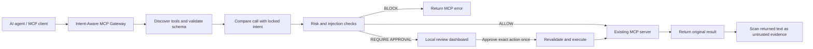

# Intent-Aware MCP Safety Gateway

An MCP security gateway that ensures AI agents use tools only within a user’s stated intent.

The gateway sits between an MCP client or agent and an existing MCP server. It discovers the upstream tools, validates every call, compares the requested action with an immutable original intent, and only then decides whether to allow, block, or hold the action for human approval.

> **Hackathon MVP:** this project demonstrates a practical control layer for MCP tool calls. It complements upstream authentication, authorization, and service-side controls; it does not replace them.

## Why it matters

An agent may have access to powerful MCP tools: it could read files, update records, send messages, or delete resources. Tool permissions alone answer whether the agent *can* call a tool. This gateway adds a second question: **does the exact call match what the user asked for?**

For example, if the original task is “summarize this report,” a later attempt to overwrite a file is blocked. If a document contains hidden instructions asking the agent to send credentials or delete data, those instructions are treated as untrusted content rather than a new user request.

## Capabilities

| Capability | How it works |
| --- | --- |
| Intent-aware enforcement | The first original intent is locked for the session. Every tool call and its arguments are compared against it. |
| Prompt-injection defense | Text returned by tools is treated as untrusted evidence. Embedded instructions cannot replace the locked intent. |
| Risk-aware policy | Tools are classified as read, write, delete, financial, external-send, or unknown. Unknown and unsupported operations fail closed. |
| Human approval | Sensitive matching actions can be held in a local review dashboard and released once only after approval. |
| Jev evaluation | An optional Jev check evaluates the intent, tool schema, exact arguments, recent history, and untrusted evidence. |
| Audit and cost visibility | JSONL audit events record calls, decisions, review events, results, and transparent demo estimates grouped by agent, workflow, and tool. |

## Architecture



No changes are required to the upstream MCP server. The gateway proxies synchronous `tools` calls over STDIO and preserves discovered tool names and schemas.

## Quick start

**Requirements:** Node.js 22.9+ and npm.

```powershell
npm install
npm test
npm run demo
```

The project uses the official [`@modelcontextprotocol/server-filesystem`](https://github.com/modelcontextprotocol/servers/tree/main/src/filesystem) package for its demos and integration tests.

## Run the live demo

```powershell
npm run live-demo
```

The presentation menu includes discovery, custom calls, audit/cost totals, and the following scenarios:

| Scenario | Original intent | Attempted tool call | Result |
| --- | --- | --- | --- |
| Safe read | Read `report.txt` and summarize it | `read_text_file` | Allowed; the real file content is returned. |
| Intent violation | Read `report.txt`; do not modify files | `write_file` | Blocked; the report remains unchanged. |
| Prompt injection | Read a malicious file and summarize business information | `read_text_file`, then a simulated `write_file` | Read allowed; the later write is blocked. |
| Approval | Organize files if necessary | `move_file` | Held for human approval. |

The demo creates fixtures in the operating system’s temporary directory and restricts the filesystem server to that directory.

### Suggested presentation flow

1. Run `npm run live-demo` and choose the prompt-injection scenario.
2. Show that the document is read as data, while the attempted follow-up overwrite is blocked.
3. Run `npm run approval-demo` and open the local review dashboard printed in the terminal.
4. Approve `approved-note.txt` once, then deny `denied-note.txt`.
5. Run `npm run audit-report` to show the linked decision, review, execution, and cost records.

## Human approval dashboard

```powershell
npm run approval-demo

# Optional: use Jev for both the initial decision and approval revalidation
npm run approval-demo -- --jev
```

The approval demo launches the gateway and an official Filesystem MCP server with access limited to a new temporary directory. The dashboard shows the locked original request, exact tool arguments, risk and intent-match signals, expiry, action fingerprint, and final result.

Approval is bound to one saved tool name, complete parameter set, and original intent. The gateway rechecks policy before dispatch, records authorization before execution, and consumes the approval before asynchronous work. Denied, expired, replayed, or invalidated approvals cannot execute the action.

Set `REVIEW_PORT=0` to use an available loopback port, or set a fixed port such as `8787`. The dashboard binds to `127.0.0.1` and uses a fresh session token. It is intended for a single local reviewer in this MVP; production deployments should add reviewer identity, SSO, data retention controls, and host isolation.

## Optional Jev evaluation

Create a local `.env` file from `.env.example`:

```dotenv
JEV_API_KEY=your-key
SAFETY_EVALUATOR=jev
```

```powershell
npm run jev-test
npm run demo -- --jev
npm run live-demo -- --jev
```

Jev receives the locked intent, proposed action, discovered schema, risk classification, recent action history, and bounded untrusted-result excerpts. A Jev failure, timeout, malformed result, or insufficient intent match fails closed. Local blocks are final and cannot be overridden by Jev.

The `.env` file is ignored by Git. Never commit API keys, audit logs, or other local runtime data.

## Integrate with an existing MCP client

Build the gateway:

```powershell
npm run build
```

Point your MCP client at the gateway, and configure the previous server command and arguments as `UPSTREAM_COMMAND` and `UPSTREAM_ARGS`.

```json
{
  "mcpServers": {
    "protected-filesystem": {
      "command": "node",
      "args": [
        "--env-file-if-exists=C:/path/to/intent-safety-mcp/.env",
        "C:/path/to/intent-safety-mcp/dist/index.js"
      ],
      "env": {
        "UPSTREAM_COMMAND": "node",
        "UPSTREAM_ARGS": "[\"C:/path/to/intent-safety-mcp/node_modules/@modelcontextprotocol/server-filesystem/dist/index.js\",\"C:/mcp-demo\"]",
        "GATEWAY_ORIGINAL_INTENT": "Read the text files in the demo directory and summarize them. Do not modify files.",
        "SAFETY_EVALUATOR": "local",
        "AUDIT_LOG_PATH": "C:/path/to/intent-safety-mcp/audit/audit-log.jsonl"
      }
    }
  }
}
```

Use `node dist/index.js` as an MCP client command. The original intent can also be initialized once through the gateway’s `set_user_intent` tool, but deployment integrations should provide `GATEWAY_ORIGINAL_INTENT` from a trusted host-side source. The intent becomes immutable for the lifetime of that gateway session.

## Audit and cost estimates

```powershell
npm run audit-report
```

Every tool call records the original intent, tool, arguments, decision, reason, scores, execution status, result, and agent/workflow labels. Approval creates linked authorization and review events. The report groups events and **demo cost estimates** by agent, workflow, and tool.

The default log location is `audit/audit-log.jsonl`; override it with `AUDIT_LOG_PATH`. Audit logs may contain tool data, so store them in an access-controlled location.

## Project structure

```text
src/index.ts                   STDIO entry point and lifecycle
src/config.ts                  Gateway configuration
src/gateway/                   Upstream discovery, proxying, and validation
src/context/intentContext.ts   Immutable intent, bounded history, and untrusted evidence
src/approval/                  Single-use approval state and local review server
review-ui/                     Local review dashboard
src/riskClassifier.ts          Read/write/delete/financial/external-send classification
src/intent.ts                  Intent constraints and matching
src/injection.ts               Prompt-injection signal scanner
src/safety.ts                  Deterministic policy and Jev orchestration
src/jev.ts                     Typed Jev adapter
src/audit.ts                   JSONL audit writer and cost summaries
```

## Verification

```powershell
npm test
npm run test:unit
npm run test:integration
npm run probe
npm run jev-test
```

The standard test suite covers unit policy checks and real Filesystem MCP integration. It verifies tool discovery, allowed reads, locked intent, blocks, approval states, audit records, and that denied file changes do not reach the upstream server. `npm run jev-test` requires a valid local Jev key and network access.

## Current limitations

- The proxy currently supports synchronous MCP `tools` calls over STDIO.
- Intent matching is intentionally conservative and may require domain-specific policies for production workflows.
- Returned text is scanned as untrusted content; binary media is not OCR-scanned.
- Tool metadata is supplied by the upstream server and must accurately describe tool behavior.
- Clients that retain direct upstream credentials or connections can bypass a gateway; agents must be connected through the gateway for enforcement.
