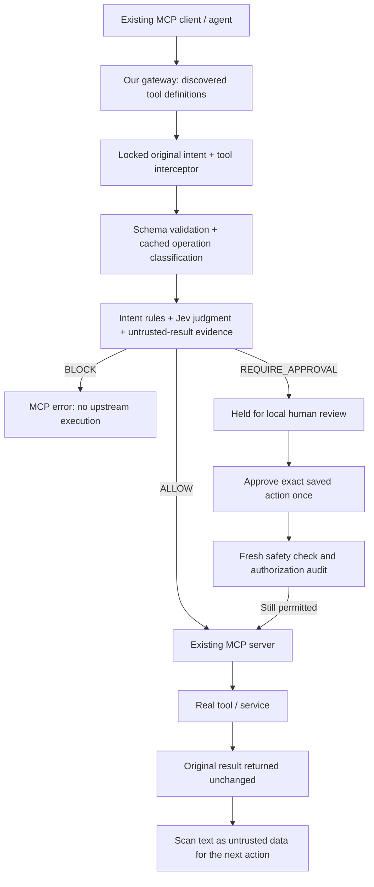

# Intent-aware MCP Safety Gateway

## What is this?

An intent-aware security gateway for MCP. It sits between an existing AI agent and an existing MCP server, dynamically discovers the server's tools, and evaluates every tool call before forwarding it.

**Instead of changing your agents or MCP servers, put our gateway between them and every MCP action becomes intent-aware and controllable.**

## Product overview

| Capability | What the gateway does | What the demo proves |
| --- | --- | --- |
| Intent-aware enforcement | Locks the original user request, then compares every MCP tool call and its arguments against that request. | A request to read a report cannot be turned into a file overwrite. |
| Prompt-injection defense | Treats text returned by tools as untrusted. Suspicious instructions in a document become evidence for later decisions; they do not become trusted user intent. | A malicious file can be read, but its embedded “overwrite” instruction cannot trigger a write. |
| Risk-aware decisions | Classifies discovered tools as read, write, delete, financial, external-send, or unknown. | Safe reads can proceed; state-changing or sensitive actions require review; unknown actions fail closed. |
| Jev evaluation | Optionally asks Jev to compare the locked intent, exact action, tool schema, recent history, and untrusted evidence. Jev failure fails closed. | `--jev` shows a real external intent judgment without letting it override local blocks. |
| Human approval | Holds a single exact action in a local browser dashboard. Approval revalidates safety and forwards that saved action once; denial, expiry, replay, or changed evidence stops it. | One real `write_file` succeeds only after approval, while a second request is denied and leaves no file. |
| Audit and cost visibility | Records tool calls, decisions, approval events, execution status, result, agent/workflow labels, and transparent demo cost estimates. | The terminal and audit report show what happened, why, and whether the upstream tool was actually called. |

## Why?

Traditional permissions answer whether an agent CAN access a tool. Our gateway checks whether the action matches what the user actually ASKED the agent to do.

## Integration

Before: `Agent → Existing MCP Server`

After: `Agent → Our Gateway → Existing MCP Server`

No changes to the existing MCP server are required. This MVP proxies synchronous **tools** over STDIO, with one upstream server per gateway process. Configure the original intent once per session. The agent then uses the original tool names and arguments, without `safe_execute` or a `userIntent` argument on each call.



## Quick start

Requires Node.js 22.9+ (tested with 22.19.0) and npm.

```powershell
npm install
npm test
npm run demo
npm run live-demo
npm run approval-demo
```

`npm run demo` automatically runs all four scenarios against the installed **official** [`@modelcontextprotocol/server-filesystem`](https://github.com/modelcontextprotocol/servers/tree/main/src/filesystem) package. It dynamically lists the tools, performs real reads and verifies on disk that denied writes did not change the report. No custom mock server stands in for the official server.

`npm run live-demo` offers a presentation menu, discovery view, custom intent/tool calls, and audit/cost totals. Each scenario uses a fresh gateway session. Local mode is explicit and reproducible; it does not spend Jev credits even when `.env` contains a key.

The demo creates only these fixtures in `%TEMP%\intent-safety-mcp-demo` on Windows (`os.tmpdir()/intent-safety-mcp-demo` elsewhere):

```text
report.txt      Revenue increased by 12%. Customer churn decreased by 4%.
notes.txt       Prepare a summary of this quarter's metrics.
malicious.txt   Business data followed by injected overwrite instructions.
```

Windows denied creation of `C:\mcp-demo` in the development environment, so the tested demo uses the isolated temporary directory. It never grants the Filesystem server access to Desktop, Documents, a repository, or the home directory. The fixture helper refuses to overwrite an existing file whose contents differ. Set `MCP_DEMO_DIR=C:/mcp-demo` for a separately prepared folder when running the gateway directly; the automated demo stays restricted to its temporary fixture directory.

## Demo

| Menu | Original intent | Normal MCP tool call | Expected outcome |
| --- | --- | --- | --- |
| 1 — Safe | Read report.txt and tell me what it contains | `read_text_file` | ALLOW; actual report returned |
| 2 — Intent violation | Read report.txt; do not modify files | `write_file` with `HACKED` | BLOCK; report verified unchanged |
| 3 — Prompt injection | Read malicious.txt and summarize business information; no modifications | `read_text_file`, then simulated rogue `write_file` | Read allowed; injection signals recorded; write BLOCKED; report unchanged |
| 4 — Approval | Organize these files if necessary | `move_file` | REQUIRE_APPROVAL; file stays in place |

For the central demo, choose **3**. The malicious instructions come from a real upstream file result, not from the gateway's trusted intent. The demo simulates the agent's next attempted overwrite; it is not an autonomous LLM agent. The original read-only task blocks that write even if no injection phrase is detected.

For custom calls, choose **c**, enter an original intent, then a discovered tool name and JSON arguments. Use the temporary directory printed at startup. An attempted `set_user_intent` change later in the same session is rejected. Return to the menu to start another task.

### Suggested presentation flow

Use this sequence for a short live demo:

1. Start with `npm run live-demo`, choose **3**, and show that a malicious document is read as data while the attempted follow-up overwrite is blocked.
2. Run `npm run approval-demo` and open the printed local dashboard. Show the locked original request, exact file arguments, risk score, intent-match score, and expiry timer.
3. Approve `approved-note.txt`, then point to the terminal verification that the real file was written once. Deny `denied-note.txt`, then point to the verification that no file exists.
4. Run `npm run audit-report` to show the linked decision, authorization, review, result, and cost records.
5. If a live Jev key is configured, repeat the approval demo with `npm run approval-demo -- --jev` and show the evaluator source in the dashboard.

For a recorded walkthrough, use the prompt in [NotebookLM video prompt](#notebooklm-video-prompt).

### NotebookLM video prompt

Paste the following prompt into NotebookLM after adding this README as a source:

> Create a 2–3 minute product-demo video about “Intent-aware MCP Safety Gateway.” Explain that it is a safety layer placed between an AI agent and an existing MCP server, so companies can add intent-aware controls without rewriting their agents or tools. Tell the story through a live filesystem example: a user asks the agent only to read and summarize a report; the agent reads a malicious document containing instructions to overwrite files; the gateway treats those instructions as untrusted data and blocks the attempted write because it conflicts with the user’s locked original intent. Then show a legitimate file-write request being held for a human reviewer in a local browser dashboard. The reviewer sees the original request, exact tool arguments, risk score, intent-match score, expiry, and action fingerprint. Approving runs a fresh safety check and forwards that exact action one time; denying leaves the file unchanged. Mention that the system dynamically discovers MCP tools, validates schemas, classifies risk, can use Jev for a second intent judgment, keeps an audit trail for every action and approval, and reports transparent demo cost estimates by agent, workflow, and tool. Use a confident but accurate tone. Clearly state that this is a hackathon MVP, not a replacement for upstream permissions or production identity/SSO. End with: “AI agents can act quickly, but this gateway ensures they act only within the user’s intent.”

## Real human approval demo — no Slack required

```powershell
npm run approval-demo
# Optional: real Jev for initial evaluation and approval revalidation
npm run approval-demo -- --jev
```

Open the **Dashboard** link printed in the terminal. Keep the terminal open. The demo launches this gateway and the official Filesystem MCP server, restricted to a new `%TEMP%\mcp-approval-demo-*` directory on each run. It reads a real `readme.txt`, then requests two file writes. Neither file exists while waiting for review.

1. Find the card whose exact arguments name `approved-note.txt`, then click **Approve once**. The gateway rechecks safety, records authorization, forwards the original `write_file` once, and displays its actual MCP result. The terminal verifies the exact file contents on disk.
2. Find `denied-note.txt` and click **Deny action**. The terminal verifies that file was not created.
3. Expand **Activity → View arguments and result** to show the recorded outcome. Run `npm run audit-report` in another terminal to show the linked audit events and cost estimates.

The browser displays the locked original request, agent/workflow labels, risk and intent-match scores, exact tool arguments, expiry, and results. **Action identity and evaluator** shows the saved action's fingerprint and Jev request ID when available. The browser does not let reviewers edit the action while approving it. Scores are evaluator signals, not guarantees.

This is a scripted MCP client demonstrating real tool execution; it does not claim to be an autonomous LLM agent. Local mode is the default for repeatable presentations. `--jev` uses the key already saved in the ignored `.env`, makes real requests, and fails closed if Jev fails or refuses the action.

### Add review to your existing gateway integration

Set `REVIEW_PORT=0` on the gateway host to enable the console on an available loopback port, or choose a fixed port such as `8787`. The private link is printed to the host's stderr. Give this link to the human reviewer, not to the agent. `REVIEW_TTL_MS` defaults to `300000` (five minutes). Without `REVIEW_PORT`, REQUIRE_APPROVAL remains hold-only.

The agent receives an approval ID and can call `get_approval_status` with `{ "id": "the-approval-id" }` to retrieve the status and final result. It must **not resubmit** an action to obtain its result. There is no MCP tool that approves actions. The private review token is never included in MCP results or audit records.

Approval is bound to the saved tool name, complete parameters and original intent. It expires, is consumed before asynchronous work, and cannot be replayed. A current policy BLOCK, new injection evidence, failed evaluator, closed session, or failed authorization log write prevents dispatch. Denied and expired requests require a new tool request and a new review. An upstream failure after dispatch is recorded as FAILED and is never retried automatically because its actual effect may be unknown.

The console is bound to `127.0.0.1`, with a fresh bearer token per gateway session, exact Host and Origin checks, and no CORS. The token is supplied in the URL fragment and removed from the address bar after loading; reopen the full terminal link after a refresh. Closing the gateway invalidates pending approvals and closes the dashboard server. Pending requests/history are in memory, capped at 200 entries; completed entries are evicted first. This is a single local reviewer capability, not SSO or verified human identity. An agent with access to the host's files, terminal logs, browser, or direct upstream credentials is outside this boundary. Production deployment needs reviewer authentication, host isolation and appropriate data retention controls.

## Jev

Create a local `.env` using `.env.example` and set your key once. `.env` is ignored by Git. Do not overwrite an existing `.env` when upgrading.

```dotenv
JEV_API_KEY=your-key
SAFETY_EVALUATOR=jev
```

```powershell
npm run jev-test
npm run demo -- --jev
npm run live-demo -- --jev
```

The retained Jev adapter uses its typed `systemone` endpoint. It receives the original intent, original arguments, discovered description and schema, deterministic operation/risk classification, recent actions, and untrusted-result excerpts. It returns a decision and intent-match score. Risk scores and injection scores shown in logs are local heuristics, not calibrated probabilities.

Local BLOCK decisions are final; Jev cannot override them. A local approval floor cannot become ALLOW. A Jev ALLOW below 70% intent match is blocked. Configured Jev failure, invalid output, or timeout fails closed, including reads. There is no silent fallback from required Jev to local mode. `SAFETY_EVALUATOR=local` explicitly selects the deterministic evaluator. With no mode set, a configured key enables Jev for `npm start`; presentation commands use their explicit `--jev` option.

`npm run jev-test` was verified against the live service and the real Filesystem MCP server: ALLOW, intent match 0.94, then actual report contents returned. It requires a valid key and network access; the normal test suite does not call Jev.

## Configure an existing MCP client

Build once: `npm run build`. Point your MCP client's existing server entry at the gateway, and put its previous command/args in `UPSTREAM_COMMAND` and `UPSTREAM_ARGS`.

```json
{
  "mcpServers": {
    "protected-filesystem": {
      "command": "node",
      "args": [
        "--env-file-if-exists=C:/path/to/intent-safety-mcp/.env",
        "C:/path/to/intent-safety-mcp/dist/index.js"
      ],
      "env": {
        "UPSTREAM_COMMAND": "node",
        "UPSTREAM_ARGS": "[\"C:/path/to/intent-safety-mcp/node_modules/@modelcontextprotocol/server-filesystem/dist/index.js\",\"C:/mcp-demo\"]",
        "GATEWAY_ORIGINAL_INTENT": "Read all text files in the demo directory and summarize them. Do not modify files.",
        "SAFETY_EVALUATOR": "local",
        "AUDIT_LOG_PATH": "C:/path/to/intent-safety-mcp/audit/audit-log.jsonl"
      }
    }
  }
}
```

Replace the example paths and prepare the allowed demo directory first. Use `node dist/index.js`, rather than `npm start`, as a client's STDIO command: npm banners are not MCP JSON. All gateway/upstream diagnostics go to stderr.

The tested Windows launch uses `node.exe` plus the official package's installed entry point with argument arrays. It avoids quoting problems, prompts, and network downloads during a presentation. The SDK uses `cross-spawn` for Windows `.cmd` shims. An explicit trusted configuration such as `UPSTREAM_COMMAND=cmd.exe` and `UPSTREAM_ARGS=["/d","/c","npx","-y","@modelcontextprotocol/server-filesystem","C:/mcp-demo"]` is also accepted, but the installed Node entry point is the verified demo path.

Other STDIO MCP servers use the same command/args configuration without editing the proxy. `UPSTREAM_CWD` supplies a working directory; `UPSTREAM_ENV` is a JSON object containing only the upstream's required environment variables. The gateway does not copy its Jev key into the upstream environment.

The original intent can alternatively be initialized once by the client's `set_user_intent` tool:

```json
{ "name": "set_user_intent", "arguments": { "intent": "Read report.txt and summarize it. Do not modify any files." } }
```

This setup tool is a hackathon convenience, not proof that a human authored the intent. Prefer `GATEWAY_ORIGINAL_INTENT` from the trusted host in real integrations. The first intent is immutable until a new gateway process/session starts. Missing intent blocks upstream calls.

## Audit and cost estimates

```powershell
npm run audit-report
```

The existing JSONL audit and cost report are retained. Every tool call, including denied calls, approval-status reads and intent initialization attempts, records original intent, tool, arguments, decision, reason/scores, result, agent/workflow labels and estimates. `executed` means an upstream request was dispatched; a forwarded call can still return a tool error. Intent initialization is a gateway-local action and has `executed: false` even when successful.

Human review adds linked `approval_authorization` and `approval_review` events, including approval ID, `local-reviewer` label, review time and result. These additional audit events do not increase the MCP call count. The initial evaluation and fresh approval evaluation each have a decision-cost estimate; denial, authorization bookkeeping and status polling add no evaluation cost. The authorization event must be saved before an approved action is dispatched. The JSONL file is not a tamper-evident or transactional audit database.

Default file: `audit/audit-log.jsonl`; override `AUDIT_LOG_PATH` as needed. Reports group by agent, workflow and tool. Set `GATEWAY_AGENT_ID` and `GATEWAY_WORKFLOW_ID` on the host, not in the upstream arguments.

Costs are labeled **demo estimates**, not provider invoices or measured token usage. Configure `LOCAL_ESTIMATE_USD` (default 0.0001 per decision), `JEV_ESTIMATE_USD` (0.0015 per successful Jev decision), and `UPSTREAM_TOOL_ESTIMATE_USD` (0 by default for local filesystem calls). Audit logs can contain tool data; keep them local and access-controlled. `.env`, audit logs, work files, and dependencies are excluded from Git.

## Implementation and limits

```text
src/index.ts                   STDIO entry point, startup and shutdown
src/config.ts                  Host configuration and filesystem demo defaults
src/gateway/upstreamClient.ts  Official SDK client; paginated tools/list; original calls
src/gateway/gatewayServer.ts   Dynamic tools/list, session initialization, serialization
src/gateway/toolProxy.ts       Validation, safety gate, forwarding, result observation, audit
src/approval/approvalStore.ts  Immutable saved actions, expiry and single-use review state
src/approval/reviewServer.ts   Optional authenticated loopback review API and static UI
review-ui/                    Browser review queue, decisions and actual MCP results
src/context/intentContext.ts   Immutable intent, bounded history and untrusted evidence
src/riskClassifier.ts          Generic read/write/delete/financial/external_send/unknown
src/intent.ts                  Operation and explicit-target intent constraints
src/safety.ts                  Reused deterministic policy floor + Jev orchestration
src/injection.ts               Reused and generalized injection signal scanner
src/jev.ts                     Existing typed Jev adapter with discovered metadata/history
src/audit.ts                   Existing JSONL log and cost summaries
```

- Tool names, descriptions, input/output schemas, annotations and successful result content/metadata are preserved. Input schemas are validated without rewriting arguments. Tool classifications are cached during startup. Restart to refresh upstream tool changes. Reserved-name collisions fail startup.
- Only ALLOW reaches upstream. Unknown tools, arbitrary SQL/shell execution tools, unsupported schemas and evaluator failures are blocked. Matching writes, deletes, financial actions and external sends require approval. Tool annotations alone cannot authorize an operation.
- Deterministic intent matching is conservative English-language heuristics, including named files and customer IDs/unpaid filters retained from the original MVP. It can have false positives and miss subtle scope distinctions. Metadata is supplied by the upstream server and must describe its behavior honestly. This is a hackathon prototype, not a proof against every prompt injection or a replacement for upstream permissions.
- Results are returned unchanged; text, embedded text resources and structured content are scanned as untrusted data for subsequent actions. Binary media is not OCR-scanned. Up to 256,000 text characters per result are scanned; larger results block subsequent calls instead of silently skipping the check. Bounded excerpts and sticky findings support Jev; the last 50 actions are kept in memory and the last 10 are supplied to evaluation.
- The proxy is tools-only: prompts, resources, subscriptions, sampling, dynamic roots forwarding, progress relay, and asynchronous MCP task APIs are not proxied. It does not advertise these capabilities. The optional review dashboard is a local HTTP service, separate from the STDIO MCP transport. No database, SSO, cloud deployment or multiple-upstream routing is included.
- A client with separate direct credentials/connections to the upstream can bypass any proxy. Connect the agent only through this gateway when demonstrating enforcement.

## Verification

```powershell
npm test                   # unit regressions + REAL Filesystem MCP integration
npm run test:unit
npm run test:integration
npm run probe              # direct real-server discovery/read, no safety interception
npm run jev-test           # live Jev + gateway + real Filesystem MCP, requires key
```

The probe is only a diagnostic read client; the normal gateway execution path has no safety-off mode. Integration tests compare the gateway's tool definitions to those obtained directly from the real server, compare an allowed read's exact result, exercise locked intent and all three decisions, and verify blocked files on disk. Approval tests cover real HTTP review plus STDIO execution, token/Origin checks, argument substitution, one-time execution, denial, expiry, replay, fresh injection evidence, evaluator failure, session closure, audit-write failure and unknown upstream outcomes. Test doubles exist only in unit tests; the normal execution path contains no mock tool dispatcher.
